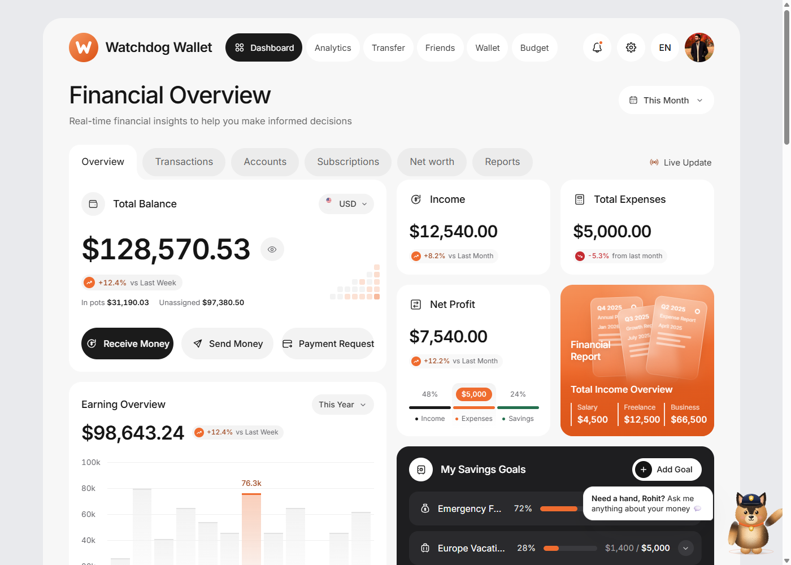
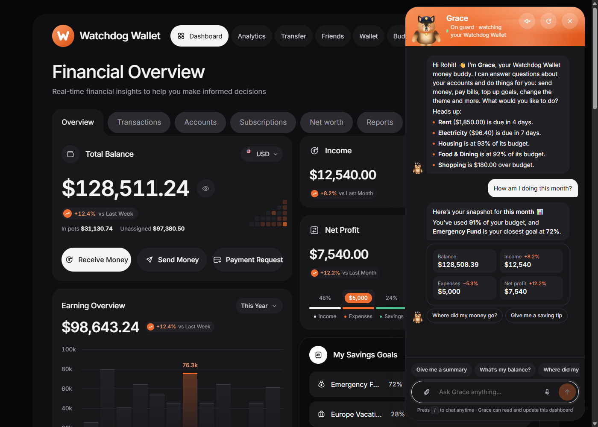
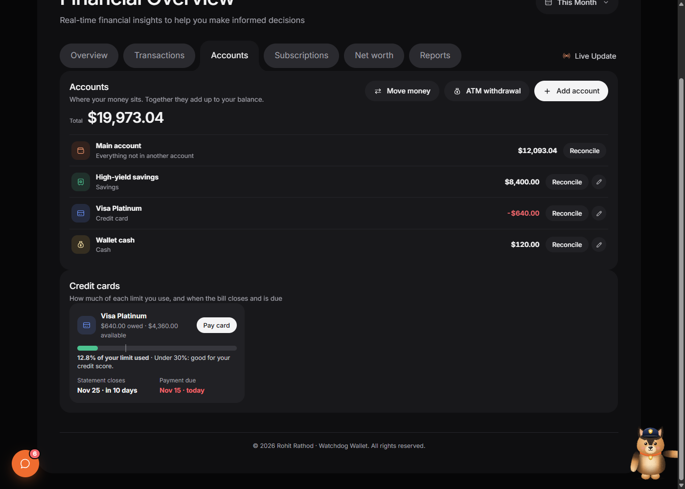
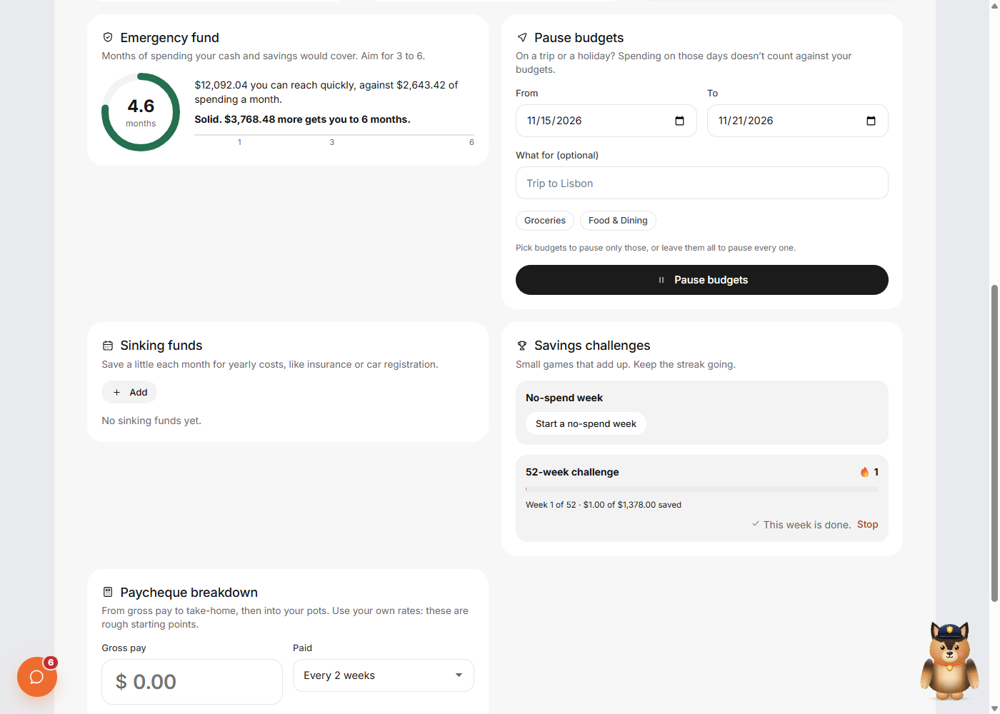
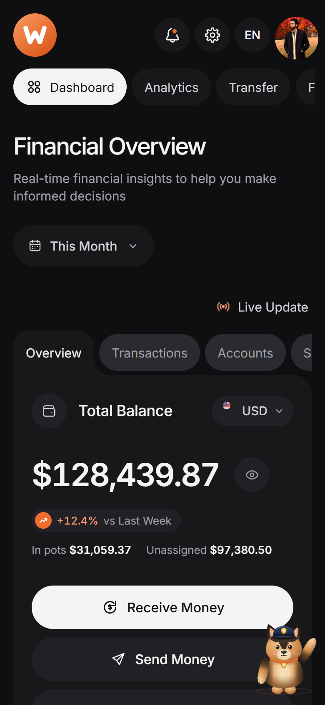

# Watchdog Wallet

**Live site:** https://rohitrathod013.github.io/Watchdog-Wallet/

Watchdog Wallet is a personal finance dashboard with accounts, friends you can chat with and pay back, card top-ups, seven languages and **Grace**, a German Shepherd puppy assistant who can answer questions about your money and act on it.

Sign up to track your own balance, transactions, budgets, goals and bills, or click **Explore the demo** on the login screen to look around with sample data and no account.

## Screenshots

| Dashboard | Grace, the assistant |
| --- | --- |
|  |  |
| **Accounts** | **Planning** |
|  |  |

---

## Features

### Accounts

- Sign up, log in, email confirmation and password reset, powered by [Supabase](https://supabase.com).
- Every account has its own private dashboard, saved automatically. Row level security means no one can read anyone else's data.
- A new account starts empty: $0, with no transactions, goals, bills or contacts.
- **Clear my data** in the account menu resets an account.
- **Your profile** (account menu): a profile photo (cropped square, and shown to your friends), your name, your **email** (a confirmation link goes to the new address and nothing changes until it's clicked), your **phone number** and your **address**.
- **Account settings** (account menu):
  - **Download my data**: everything in the account as a JSON file.
  - **Deactivate account**: pauses the account and logs out. The data is kept, and logging in again shows a **Reactivate** button.
  - **Delete account**: removes the login and all its data for good, after typing DELETE and the password. Grace never does this from chat; she opens Account settings instead.
- **Explore the demo** opens a full sample dashboard without an account. Nothing in the demo is saved.
- **Security** (account menu):
  - **Two-step login**: add a code from an authenticator app (Google Authenticator, 1Password, Authy). Once it's on, your data only opens after the code, on every device: the database itself refuses a session that hasn't entered one.
  - **Unlock with a passkey**: when Grace locks the app, open it with your fingerprint, face or PIN on that device instead of typing the password.
  - **Where you're signed in**: every device with its browser, last use and IP address. Sign out one of them, every other device, or everywhere.
- **First-run tour**: a new account gets a five-step tour (adding money, budgets, cards and pots, Grace), each step with a button to the feature. Skippable, shown once, and **Take the tour** in Settings replays it.

### Your money

- **Add transaction**: record money in or out with a description, category and date.
- **Repeating transactions**: set up rent, salary or a subscription once (weekly, every 2 weeks, monthly or yearly) and it's added by itself on its date, with your balance following. Pick **Repeat** when adding a transaction, or manage them all under **Repeating** on the Transactions tab: pause, resume or remove. A rule for the 31st runs on the last day of shorter months. If you were away, missed ones are caught up (24 at most per rule); resuming a paused rule skips what it missed.
- **Import a bank statement**: **Import** on the Transactions tab reads a CSV export from your bank, in the browser, without uploading it. It finds the date, description and amount columns (one signed amount, or separate money out and money in), copes with day-first or month-first dates and 1,234.56 or 1.234,56 numbers, suggests a category for each row, and unticks rows that look like ones you already have. You review everything before it's added, and can choose whether the balance changes too.
- **Import a PDF statement too**: the same window takes PDF statements, read on your device; dated lines with amounts become rows, and the running balance tells money in from money out. CSV is still the most reliable.
- **Split my income**: **Split pay** on the Pots card sets percentages of your pay that go into pots and goals by themselves when salary (or other income you pick) lands, whether you add it by hand or it arrives as a repeating transaction. A goal only takes what it still needs; the rest stays unassigned.
- **Pay by card**: top up your balance with a card through Stripe Checkout (see [Card payments](#card-payments-stripe)).
- **Add contact**, **Add bill** and **Add Goal**.
- **Send money** and **request money** from your contacts. **Pay bills** and **top up goals** in one tap.
- **Accounts** (Dashboard > Accounts): split your balance by where the money actually is: checking, savings, a cash wallet and credit cards, each with its own balance, adding up to your total. **Move money** between them (it never counts as income or spending), and **ATM withdrawal** moves money into your cash account. Card payments go to the card's account and cash payments to the cash account by themselves.
- **Reconcile**: tick off each transaction that's on your bank statement, type the statement's ending balance, and see straight away whether they agree.
- **Notes, tags and saved searches**: tap any transaction to add a note, tags (#work, #trip) or change its account or category. Search with words, #tags or over:50, filter by tag, and save a search to come back to it.
- **Receipt photos**: attach a photo or PDF of the receipt to any transaction. They're kept in a private storage folder only you can open.
- **To claim back**: mark an expense as one work or a friend owes you, and press **Paid back** when the money arrives (the Reports tab lists what's still owed).
- **Undo a send**: money to a contact or a friend goes after 5 seconds, with **Undo** on screen until then.
- **Delete by date**: clear out old transactions between two dates without touching your balance, budgets or goals.
- **Add while offline**: with no connection, transactions you add are kept on the device and saved as soon as you're back online.
- **Log from your home screen**: long-press the installed app's icon for **Log an expense**, or have a phone assistant or an iOS Shortcut open the app's link with `?log=12 coffee`: it's read into an expense, filled in for one tap. Sharing text to the installed app does the same.
- **Receipts inbox**: forward receipt emails to your own private address (or connect Gmail, read only) and each one waits as an expense to check, with the shop, amount and date read from it. Add it (Grace suggests the category) or dismiss it.
- **Add to calendar** (Subscriptions tab): download your bills and repeating payments as an .ics file, or subscribe to a private link so Google Calendar, Apple Calendar or Outlook stay up to date, each with a reminder the day before.
- All charts and totals are worked out from your own transactions: income, expenses, net profit, savings rate, earnings by month, 12-month cash flow, spending by category, budget usage and a 52-week spending heatmap.
- Currency switcher (USD, EUR, GBP, JPY) and period switcher (week, month, quarter, year).
- Export transactions and reports as CSV.
- CSV exports are spreadsheet-safe: a name like "=HYPERLINK(...)" from an imported statement is never run as a formula.

### Planning

On the Budget page, below the budgets:

- **Emergency fund meter**: how many months of spending your cash and savings would cover (credit cards don't count), with how much more gets you to 3 and to 6 months.
- **Pause budgets**: going on a trip or a holiday? Pick the dates (and which budgets, or all) and spending on those days doesn't count against them. The trip still shows in your spending; the budget cards say how much was left out.
- **Sinking funds**: yearly costs like insurance or car registration, with the monthly amount to put aside worked out from the due date. **It's paid** records the cost from the fund and starts saving for next year.
- **Paycheque breakdown**: gross pay to take-home after federal and state tax, Social Security, Medicare, retirement and other deductions (your own rates), per paycheque, month and year. Record it in one tap, and your income split sends it into pots.
- **Savings challenges**: a no-spend week (rent, bills and groceries don't break it, eating out and shopping do) and the 52-week plan ($1 in week 1, $2 in week 2, and so on to $1,378), each with a streak.
- **Credit cards** (Dashboard > Accounts): how much of each limit you use (under 30% is what lenders like), what's available, and the next statement close and payment due dates, with a reminder a few days before it's due.

### Friends

- **Add friends** by the email they signed up with, or share your **invite link**. They accept, and you're connected.
- **Add from your contacts**: after you agree, your phone opens its own contact list and you pick who to share. The site only sees the people you pick, sends a friend request to each one already on Watchdog Wallet, and offers a text or email invite for the rest. Nothing else from your contacts is saved. This uses the browser's Contact Picker, which works in Chrome on Android; elsewhere the page explains that and points to email or the invite link.
- **Friend requests in your notifications**: the bell shows each new request with **Accept** and **Decline** right there, and it disappears once answered.
- **Chats from any page**: a round chat button in the bottom-left corner (with the unread count) opens a small window with your friends and groups, newest first. Pick one and chat, send, request or split right there without leaving the page you're on. On phones it fills the screen. It's hidden on the Friends page, which has the full view.
- **Chat** with each friend, live, with a badge on the Friends tab for unread messages and requests:
  - messages from the same person are grouped with one timestamp, with **Today**, **Yesterday** or date dividers between days;
  - your latest message shows **Sent**, then **Seen** once your friend has opened the chat;
  - a **typing…** indicator while your friend writes (a live signal, nothing is stored);
  - messages appear the moment you send them, and a failed one can be retried with a tap;
  - the message box grows as you type: **Enter** sends, **Shift+Enter** adds a line;
  - an **emoji** picker and **quick replies** (👍, Thanks!, On my way, Sounds good, Paid you back 💸);
  - links are clickable, and emoji-only messages show large;
  - **photos and videos** (big photos are shrunk before upload, and open full screen with a tap), **files** like PDFs, and **voice notes** with a waveform you can scrub through. Pick them with **+**, take a photo with the camera on a phone, paste or drag a picture in, or tap the **mic**. Files can be up to 10 MB;
  - scrolled up to read? A **new messages** button takes you back down.
- Payments, requests and splits show as cards in the chat, with **Pay** and **Decline** right there. **Send**, **Request** and **Split** are also in the chat header and the **+** menu.
- The chat is a fixed-height window that fits the screen: only the messages scroll. On phones it takes the whole screen.
- **Send money** to a friend: it leaves your balance and lands in theirs, and both of you see it in your transactions.
- **Request money**: your friend gets a card in the chat and pays it in one tap, or declines.
- **Split a bill** like dinner or rent: pick friends, include your own share or not, and each friend gets a request for an equal share (leftover cents go to you). Or split **by amount** or **by percent**, and whatever's left is your share. You can also add the full bill to your own spending.
- **Monthly splits**: tick **Repeat every month** for rent or utilities with a flatmate and the same split is sent again on that day every month. The Friends page lists them, with **Stop**.
- **Payment links** (Transfer page): ask anyone for money, even someone without an account. Share the link or its QR code; they pay by card on a small page (Stripe Checkout) and the money lands in your balance once.
- **Family**: link a teen's or kid's account (they need to be your friend first, and accept). An allowance is sent from your balance every week or month, and with approval on, their spending comes to you first: you approve or decline it, and they're notified either way.
- **Who owes who**: each friend shows "owes you" or "you owe" from the open requests.
- **Groups** of up to 25 people for a trip, a flat or a team:
  - start one with **New group**, give it a name and pick friends;
  - the same chat as with one friend (photos, videos, files, voice notes, typing…), with each person's name on their messages and **Seen by** on yours;
  - **Split a bill** with the group: every member gets a request for their share and pays it right in the group, even if they aren't your friend directly. The person who paid sees who has paid and who hasn't;
  - **Group shares are confirmed by whoever paid the bill**: paying your share (in the app, or marking it paid another way, like cash or a bank transfer) shows as "waiting for Ana to confirm" until the person owed taps **Confirm**, or **Not received** to put it back to unpaid. An in-app payment only leaves your balance when it's confirmed, and the person owed gets a push notification to confirm. The server enforces it, so a share can't be settled any other way;
  - **Settle up**: after a few splits, a group's debts turn into the fewest payments that clear them. The window shows what each person is owed or owes, today's payments and the simpler plan (for example, Ana pays Bob, Bob pays Carol, Carol pays Ana becomes one payment, or none). Nobody ends up owing or being owed a different amount; only who pays whom changes. The old requests are cancelled, the new ones appear in the group with a **Pay** button, and the chat says what happened;
  - **Trips**: a group trip budget with a total and (optionally) one per category, and a running total everyone in the group sees. Bills split in the group can go to a trip and a category;
  - **Shared goals**: **Goals** in a group chat lets the group save towards something together (a trip, a gift). Each person adds money from their own balance (recorded as savings); everyone sees the progress and who put in what, and the chat says when someone adds to it;
  - admins can rename the group and add or remove people; anyone can leave, and if the last admin leaves, the longest member takes over.
- Grace's payment guard (large-payment check, first-payment warning) works on friend payments too.

### Markets and investing

At the bottom of the Overview tab:

- **Watchlist**: Crypto and Stocks tabs with live prices and the 24-hour change. Search **any coin** CoinGecko lists or **any US stock or ETF**, and add or remove it. Coins show a 7-day trend line; stocks show where the price sits in today's range. Each account keeps its own list.
- **My Investments**: press **Buy** on anything in the watchlist to record a purchase from your unassigned money or a pot. Holdings are valued live, with profit or loss per holding and in total, and **Sell** puts the money back in your balance.
- **Investing in detail**: allocation (by holding and crypto vs stocks), how your picks compare with putting the same money in the S&P 500 (SPY) on the same days, realised gains (short and long term, oldest lots sold first), **dividends** you record, and each lot's cost basis.
- **Exchange Rates**: European Central Bank rates against your dashboard currency, with a quick converter.

Investing here is **tracked, not traded**: Watchdog Wallet records what you bought and follows its value, but places no real orders, so buy through your broker or exchange as well. Buys and sells are saved with the status "Invested", so they never count as income or spending in the charts.

### Pages

- **Dashboard**, with six tabs:
  - **Overview**: balance, earnings, KPIs, savings goals, cash flow, spending, quick transfer, recent transactions, bills, budget health and the spending heatmap.
  - **Transactions**: search, filters, sorting and CSV export.
  - **Subscriptions**: everything you pay for on repeat in one list: the repeating transactions you set up plus repeat charges Grace spotted in your history. Monthly and yearly cost, next charge date and price rises. **Make it repeating** turns a spotted charge into a rule, and **Remind me to cancel** sends a notification 2 days before the next charge.
  - **Net worth**: cash, savings goals and investments (at today's market value, with what you paid shown next to it), plus a home, car or pension you add, minus loans and cards you owe on, with the change since last month and a snapshot each month for the trend chart. The **Debt payoff planner** takes each debt's interest rate and minimum payment plus any extra you can pay each month, and compares the **avalanche** (highest rate first, the cheapest) with the **snowball** (smallest balance first, the quickest wins): the debt-free month, the interest each costs, and the order debts clear.
  - **Accounts**: your accounts and credit cards (see [Your money](#your-money) and [Planning](#planning)).
  - **Reports**: income by source, downloadable statements, the **year-end tax summary** (income, tax already paid, realised gains, dividends and spending you tagged as tax deductible, by category, exported as CSV) and what's still to be **claimed back**.
  - **Monthly statement (PDF)**: pick a month and it opens a print-ready statement (opening and closing balance, money in and out, spending by category, how each budget did, every transaction); choose "Save as PDF" in the print window. Or tick **Email me last month's statement** and it arrives on the 1st of each month.
- **Analytics**: KPI sparklines, cash flow, earnings, spending and the heatmap.
- **Transfer**: quick transfer, recent transfers and transfer limits.
- **Friends**: friend requests, groups, your friends with who owes who, invite link, and a chat with each friend or group.
- **Wallet**: your cards, balances by currency and bills.
  - **My Cards** starts empty. **Add card** saves a name, debit or credit, the network (Visa, Mastercard, American Express, RuPay or other), an optional expiry and a colour, plus **only the last 4 digits**: the app never asks for or stores a full card number, PIN or CVV. Your cards appear under **Paid with** when you add an expense, so locked budgets apply to them. Flip a card to remove it (two taps).
  - **Bank and card terms**: a link under My Cards and on the card top-up. They say plainly what the app is (a money tracker, not a bank), what's stored about a card, that locked budgets don't block a real card, how Stripe top-ups and money between friends work, and how your data is kept. You agree once before adding your first card or paying by card; the agreement and its version are saved with your account, and changing `TERMS_VERSION` in `src/lib/terms.js` asks everyone again. The terms text is in English; the buttons around it are translated.
- **Budget**: category budgets with a one-tap smart rebalance.
  - Monthly limits per category. **Add a budget** for any of 23 spending categories (Groceries, Utilities, Subscriptions, Insurance, Education, Pets, Kids, Gifts & Donations, Debt Payments, Taxes and more) or make up your own, and remove any with two taps. Custom categories also appear when you add an expense or a bill, so their spending is counted.
  - **Rollover**: tap the circular arrow on a budget and whatever it doesn't use is added to next month's limit, counted from the month you turn it on (up to 12 months back). Overspending a month eats into what was carried, never below zero. The card shows the limit and the carried amount separately.
  - **Locked budgets**: tap the lock on a budget (or tick it when adding one) and what's left of it is set aside for that category only. A card payment for Groceries uses the Groceries money first, then free money; a card payment for anything else, or a transfer, can only use the money that isn't locked, and is declined if it would dip into it. The payment window says where the money will come from before you pay, and the Budget page shows how much is locked and how much is free to spend. Cash records aren't blocked, since that money is already spent.

### Grace, the guard dog

Grace wears a guard cap and a gold shield badge, and she guards the account (**Grace's guard** in the account menu, or ask her for a "security check"):

- **Auto-lock**: after a set time with no activity (15 minutes by default) the app locks behind Grace, and unlocking a real account needs its password again. A reload doesn't get past the lock, and Grace's chat is shut while it's locked. **Lock now** is in the account menu, or say "lock the app".
- **Large payment guard**: payments at or above your limit ($500 by default) need an extra step, a tick box in the payment windows or a second tap on Grace's confirm button.
- **First payment warning**: before you pay someone for the first time, Grace asks you to check it's really them.
- **Privacy blur**: optional. Blurs your numbers whenever you switch to another tab or app, for screen sharing.
- **Scam warnings**: messages like "someone asked me to buy gift cards", "move my money to a safe account" or "install AnyDesk" get a clear warning and what to do.
- **Watchdog scam shield**: ask "is this a scam?" and paste a message, email, link, invoice or payee (or just paste a link or a long suspicious message) and Grace scores it 0 to 100 as low, medium or high, with every reason shown next to the exact words that triggered it and how much it counts. It's **rule-based, explainable and local**: about 20 weighted signals (unusual payment methods, requests for codes, remote-access apps, secrecy, pressure, prizes, small "release" fees, changed bank details, impersonation) plus static link checks (look-alike domains against 50 well-known brands, short links, bare number addresses, punycode, link text that doesn't match the target), combined with diminishing returns so one weak signal never reads as high. Links are only read as text, never opened. Before a payment, the same shield checks your own history on this device: a payee you've never paid, an amount over 3× your usual, a name a letter off one of your contacts, or a bill more than 20% above the last one. These show in Grace's confirm and the payment windows as warnings, never blocks. The receipt scanner flags changed bank details and new payees too. **Report as safe** or **Report as scam** keeps your verdict on this device only. Nothing you paste leaves the device unless you tap **Get a plain-language explanation**, which first shows exactly what would be sent to the AI model; the model only explains, it never changes the score. On the small hand-written test set in `tests/shield.test.js` (20 scams, 20 normal messages, not real traffic) it scores 95.2% precision and 100% recall.
- Settings are saved per account, and Grace can change them: "auto-lock after 5 minutes", "set my guard limit to $300", "turn on privacy blur".

### Grace, the assistant

- Flies in when the page loads, then sits in the corner, blinks, follows the pointer and waves. Press **/** anywhere to open the chat, or tap the microphone to speak.
- **Answers from your own data**: balance, income, spending, budgets, goals, bills and pots.
- **Finds transactions**: "what did I spend on food last week", "show Uber charges this month", "anything over $100". Follow-ups like "and last month?" keep the context.
- **Explains changes**: "why is my spending up?" compares with last month and names the categories and purchases behind it.
- **Warns before you ask**: bills you can't cover, budgets near the limit, duplicate charges and subscription price rises show up when the chat opens.
- **Forecasts** your end-of-month balance from bills still due and your usual daily spending, and lists your **subscriptions** with monthly and yearly totals.
- **Knows your locked budgets, rollover and repeats**: "can I spend $80 on dinner?" checks free money against what's locked; "how much is free to spend?", "what's coming out this week?", "what carried over?"; and with a confirm step, "lock my groceries budget" or "turn on rollover for groceries".
- **Weekly recap**: once a week a notification sums up the week before (spending, the change from the week before, where most of it went); ask "how was my week?" for the full version, with the biggest payment, anything unusual, budgets near their limit and what's due this week.
- **Suggestions**: Grace spots small changes that would fit how you actually spend: a budget that went over 3 months in a row ("raise it to $450?"), a category with $150+ a month and no budget, or a bill-like charge paid 3 months running that isn't a repeating transaction. One shows when the chat opens; ask "any suggestions?" for all of them. Each has **Apply** and **Not now**, and dismissed ones don't come back.
- **Net worth and debts**: "what's my net worth?" and "when will I be debt-free with $200 extra a month?".
- **Reads your files**: the paperclip next to the message box takes a photo or screenshot of a receipt or bill, a PDF (receipt, bill or bank statement) or a CSV statement; you can also drop or paste a file. Receipts and bills become an expense to confirm; statements open in the import window to review.
- **Answers common money questions herself**: credit scores, Roth IRAs, 401(k)s, paying off debt or saving first, compound interest, index funds, inflation, the 50/30/20 budget and more, so they work even when the AI model is busy.
- **Plans**: "can I afford a $1,200 trip in March?" answers with the trade-off; "save $5k by June" gives a weekly amount, which budget to trim, and can create the goal.
- **Takes actions with a confirm step**: record spending or income from a sentence ("I spent $300 on dinner"), send or request money, pay bills, move money between pots, top up goals and change budgets. Several in a row work too ("move $200 to savings, then pay the electric bill, then tell me what's left"), and "make it $80" changes the last amount.
- **Helps with the site** ("where do I export a CSV?") and explains terms like fees, overdrafts, APR, pending or chargebacks.
- **Stays safe**: it never asks for or keeps passwords, PINs or card numbers (they're hidden on screen), gives information rather than investment advice, and points fraud, disputes and locked accounts to the bank or password reset.
- **Keeps an audit trail**: every change Grace makes is saved in **Grace's activity** (account menu) with what you asked and why, and "why did you do that?" explains the last one.
- **Live data, no keys needed** (`src/lib/live.js`, cached so free limits are never hit):
  - **Exchange rates** from the European Central Bank via [Frankfurter](https://frankfurter.dev): "what's $100 in euros?", "50 pounds to rupees", "usd to eur". The currency switcher uses the same live rates.
  - **Crypto prices** from [CoinGecko](https://www.coingecko.com) for any listed coin: "bitcoin price", "price of chainlink", "how is pepe doing".
  - **Stock prices** for any US stock or ETF via Finnhub (see [Stock prices](#stock-prices)): "nvidia stock price", "$AAPL", "my stocks".
  - **Watchlist and investing**: "add chainlink to my watchlist", "buy $200 of bitcoin", "buy 2 shares of apple", "sell half my ethereum", "how are my investments". Buying and selling always ask for a confirm, and Grace still won't recommend what to buy.
  - **Public holidays** from [Nager.Date](https://date.nager.at): "any bank holidays soon?", "are banks open on Monday?", "holidays in the UK". Grace also warns when a bill falls on a bank holiday.
- **Reads receipts and bills**: tap the 🧾 button next to the message box (or paste a picture) and send Grace a photo. She reads it right in your browser with [Tesseract.js](https://tesseract.projectnaptha.com) (free, the photo isn't uploaded), finds the shop, total, date and any due date, and offers to **add it as spending** in the right category, or as a **bill** with its due date so she can remind you. Nothing is added until you confirm. Clear, straight-on photos of printed receipts work best; the reader downloads once (a few MB) the first time.
- **Shows her work**: every figure Grace states (balance, income, spending, a category, search totals, "why is my spending up", the month-end forecast, subscriptions, "can I afford it?" and savings plans) has a **How I got this** link. It opens the formula in one sentence, the steps, and the exact transactions used (10 at a time, with "show all"), plus **Copy as CSV**. All the maths is done in whole cents, and the tests check that every total equals its rows to the cent. When Grace does something for you, the numbers behind it are kept in her activity log, so "why did you do that?" shows them too. The demo's sample totals aren't sums of its transactions, so they don't get a trace.
- **The model never computes figures**: numbers only ever come from Grace's own code. If an answer from the LLM mentions an amount, it's marked **Not verified** and never gets a trace.
- **Answers anything else with a free LLM**: when a question isn't one of Grace's own ("how does a Roth IRA work?", "should I pay off debt or save first?"), she asks a hosted model, Google Gemini's free tier by default (see [Grace's LLM](#graces-llm)). It sees only the question, the last few messages and a short summary of your account, and it can only talk: sending money, paying bills and changing settings still go through Grace's own rules and your confirm. In the demo, or if the model is unavailable, she answers as before.
- **Talks back**: the speaker button in the chat header reads every reply aloud, and questions asked with the microphone are always answered out loud.
- **Forgives typos**: "whats my balnce", "I spnet $30 on dinnr" and "send $50 to varsah" all work. [Fuse.js](https://www.fusejs.io) matches each unknown word against Grace's vocabulary and the names on your account (`src/lib/typos.js`), with strict rules so real words like "tax" or "crash" are never changed.
- Understands some Roman Urdu, such as "balance kitna hai" and "kal 300 ka khana kharch kiya".
- **Tested**: `npm test` runs 240+ example questions with expected answers (`tests/grace.test.js`), plus checks for Grace's voice and the Friends money maths, and GitHub runs them all before every deploy.

### Languages

English, Español, Français, Deutsch, العربية, Português and हिन्दी. Everything is translated, including Grace's replies. Each language's words are downloaded only when it's picked. Arabic switches the whole layout to right-to-left. The chosen language is remembered.

### Look and feel

- Light, dark and **Auto** themes, with a liquid transition between them. Auto (the default) is light from **sunrise to sunset where you are** and dark at night, and switches by itself at those moments. The rough location comes from your internet address via [geojs.io](https://www.geojs.io) (free, no key, city level, no permission prompt) and is kept for a week; sunrise and sunset are worked out on your device. Without a location it uses 7am to 7pm. Settings shows today's times, and Grace can turn it on ("auto theme").
- 5 accent colours.
- Staggered entrances, counting numbers, self-drawing charts and sections that reveal as you scroll.
- Reduce motion setting, and respect for the system reduced-motion preference.
- Works on phones (tested down to 360px wide), tablets and desktops.
- **Accessible**: checked with axe against WCAG 2.1 AA on every page, in light and dark: text contrast meets 4.5:1, every control has a name that matches what it shows, and motion respects the reduced-motion setting.
- **Installable**: add it to your home screen (Chrome: the install icon in the address bar; iPhone: Share > Add to Home Screen) and it opens like an app, with its own icon. A service worker (`public/sw.js`) keeps the app's files, so it **opens without a connection**. Your account's data is never cached by the service worker; instead the app keeps a copy of it on the device after each load and save, and with no connection it opens that copy with a banner saying when it's from, read only until you're back online. Signing out, deactivating or deleting the account removes the copy.
- **Push notifications** (Settings > Notifications when closed, per device): new messages, friend requests, money requests and payments received, and a reminder the day before a bill is due, even when the app is closed. Sent by the `push` Edge Function through standard Web Push; each device's push address is saved to the account and removed when push is switched off.

## Tech stack

React 19, Vite 8, Framer Motion 12, Supabase (auth with two-step login, database, storage, Realtime, Edge Functions and pg_cron), Stripe Checkout (card top-ups and payment links), WebAuthn passkeys, Postmark (receipts by email), the Gmail API, Brevo (statement emails), qrcode-generator (QR codes), Google Gemini (Grace's free-form answers), Fuse.js (Grace's typo matching), Tesseract.js (Grace reading receipts), and plain CSS with design tokens. No UI kit and no chart library: every chart is hand-built SVG.

## How it works

### Accounts and data

Accounts, the database, file storage, live updates and the server functions all run on [Supabase](https://supabase.com). Each account's dashboard is one private row in `user_state`; row level security means only its owner can read or change it. [`supabase/schema.sql`](supabase/schema.sql) holds every table, security rule and SQL function. Only the publishable key is in the app; every secret key (Stripe, Finnhub, Gemini) lives in Supabase and is used only by Edge Functions.

### Friends, chat and shared money

- Row level security shows each person only their own friends, messages, requests and transfers. People who aren't friends can't see each other, chat or send money.
- Money only moves through SQL functions (`send_to_friend`, `request_from_friend`, `create_split`) that check both people are friends, the amount is between $0.01 and $10,000, and a request is still open, so it can't be paid twice.
- Settle up uses two more: `group_debts` lets a group's members see every open debt in that group, and `simplify_group_debts` replaces them with the fewest payments on the server, inside one transaction, so two people can't do it at the same moment.
- Each transfer is added to both people's balances exactly once: the transaction keeps the transfer's id.
- Live updates use Supabase Realtime.
- Photos, videos, files and voice notes go in a private Storage bucket, `chat-media`. Files sit in a folder per pair of friends, only those two can open them, and links to them expire after an hour.
- Groups live in `groups` and `group_members`; only members can see a group, its messages and its files. The functions `create_group`, `add_group_members`, `remove_group_member`, `leave_group` and `rename_group` enforce the 25-person limit and the admin rules.
- Deleting an account removes its profile, friendships, messages, requests, transfers and uploaded files.
- The demo shows a "create an account" card on the Friends page, because friends need two real accounts.

### Security

- **Two-step login** uses Supabase Auth's TOTP factors. A restrictive row level security policy on `user_state` (`mfa_ok()` in `schema.sql`) only lets a session that entered the code read or change the data once a factor is on, so it can't be skipped from the browser.
- **Signed-in devices**: `my_sessions()` lists your own sessions from Supabase Auth and `end_session()` ends one; **Sign out everywhere** revokes every refresh token.
- **Passkey unlock** is WebAuthn with the device's own authenticator (fingerprint, face or PIN, user verification required). It only unlocks a session that's already signed in on that device.

### Payment links, trips and family

- **Payment links** are rows in `pay_links`, only visible to their owner. The public page asks the `payments` function for the amount, starts a Stripe Checkout and, on the way back, checks with Stripe that it was paid in full before the link is marked paid. The owner's app then adds it to the balance once, keyed by the Stripe session.
- **Trips** (`group_trips`) belong to a group; a split gets a `trip_id` and a category through `tag_split`, which only its creator can do.
- **Family** (`family_links`, `spend_requests`): only friends can be linked, a child account can't add children, the allowance moves like any friend payment (`pay_allowance` checks the date), and a request can only be decided by the parent and recorded once by the child.

### Receipts by email, statements and the calendar

- **Email receipts** arrive at a [Postmark](https://postmarkapp.com) inbound address with a private token after the "+"; the `inbound-email` function reads the shop, amount and date and saves them in `pending_expenses`. **Gmail** uses Google sign-in with read-only access; its refresh token is kept in a table no policy lets anyone read, and only the `gmail` function uses it. Only the amount, shop, date and subject are kept, never the email.
- **Monthly statements by email** are sent by the `statement-email` function on the 1st (pg_cron) through [Brevo](https://www.brevo.com), only to people who turned them on.
- The **calendar feed** is served by the `calendar` function at a private link (a 64-character token); making a new link stops the old one.

### Profile: email verification and photos

- **Email**: changing it goes through Supabase Auth, which sends a confirmation link to the new address. The email only changes once the link is clicked.
- **Photo**: stored in a public `avatars` bucket, one folder per user, so only the owner can change it. Photos are cropped to a 320px square JPEG before upload.
- **Phone and address**: saved on the login (`user_metadata`), visible only to that person.

### Card payments (Stripe)

**Add money > Pay by card** tops up the balance with a card payment on Stripe's own Checkout page, so card numbers never touch the site. The Stripe secret key lives only in a Supabase Edge Function ([`supabase/functions/payments`](supabase/functions/payments/index.ts)). It creates the payment page and, when Stripe sends the user back, checks that the payment is paid and belongs to that account. Each payment is saved with its Stripe id, so it can't be counted twice. Card payments only show for signed-in accounts, not the demo. The site runs in Stripe's test mode (card `4242 4242 4242 4242`, any future date, any CVC), so no real money moves.

### Stock prices

Crypto prices and exchange rates come from free public APIs. Stock prices come from [Finnhub](https://finnhub.io) through a Supabase Edge Function ([`supabase/functions/stocks`](supabase/functions/stocks/index.ts)), so the API key is never in the website; the function caches answers to stay inside the free plan's limits. It covers US stocks and ETFs.

### Grace's LLM

Grace's own rules handle every action. For questions they don't recognise, the chat calls a Supabase Edge Function ([`supabase/functions/grace`](supabase/functions/grace/index.ts)) that keeps the API key on the server and passes the question to Google Gemini (the newest Gemini Flash, falling back to other Flash models when one is busy). Only signed-in accounts use it; the function checks the login itself.

If Gemini is over its free limit or busy, the question goes to a backup provider (Groq's free Llama models) instead, so Grace keeps answering.

What the model sees: the question, the last 10 messages, and a few lines about the account (balance, this month's totals, budgets, goals, unpaid bills, pots and the latest 8 transactions), with any run of 4 or more digits hidden. If the model is busy or unavailable, Grace gives her usual answer.

## ML in Grace

Three small models run **on your device, on your own transactions**: no server, no API key, no LLM. They're written from scratch in plain JavaScript (`src/lib/ml/`), use fixed random seeds so the same data always gives the same answer, and **only propose**: every output has a reason, a confidence and a "How I got this" trace you can check.

**Unusual spending, in two stages.** (1) An **Isolation Forest** (100 trees, 64-point samples) looks at eight features per payment: amount, log amount, how common its category and merchant are, hour, weekday, days since the last visit to that merchant, and the amount compared with the category's median. It proposes anything easy to isolate from the rest. (2) A proposal is kept only if a **robust z-score** (median and MAD, at least 3) confirms it against your own history for that merchant, else that category, else everything when there are fewer than 5 samples. Why two stages: the forest alone flags anything rare and its score means nothing to a person; the z-score turns it into a reason you can check ("Amount $240 vs typical $35 for Dining") and stops it fitting on noise. Simple rules sit alongside: the same charge twice within 48 hours, a subscription price rise, and a big first payment somewhere new. It needs 30 payments before it starts, and says so. Investments and moves between pots are never looked at. Each flag has **Dismiss** and **Confirm**; dismissed patterns stop alerting. When the chat opens, Grace shows at most 2 flags. Accounts over 400 transactions run this in a Web Worker.

**The month-end forecast is a range.** Known items (unpaid bills, your repeating transactions on their real dates, plus repeat payments and pay spotted in your history that haven't landed yet) go on their days. Everyday spending is **bootstrapped**: each remaining day draws a real past day of yours, weekdays from weekdays and weekends from weekends, and each of 1,000 runs first resamples those days so the uncertainty in your typical level is included too. Grace says it plainly: "Most likely about $820 left. 80% chance it lands between $540 and $1,050. 7% chance you go below zero, most likely around Oct 26." The Cash Flow chart shows this month's likely spending as a shaded band. Under 60 days of history the band is widened and labelled a rough estimate.

**Categories that learn.** Multinomial naive Bayes (Laplace smoothing) over the words in a transaction's name, trained only on your own transactions, your corrections and a seed list of about 260 common merchants (`src/data/merchants.js`). An exact name you've corrected, or one you always file the same way, is used directly. Under 60% sure it asks instead of guessing. It's used when you add a transaction, scan a receipt, or tell Grace "I spent $30 at Trader Joe's". Say "that's wrong, it's groceries" (or overrule the guess in the Add transaction window) and it learns at once, then offers to fix similar past transactions, showing how many first. Only the corrections are saved with your account; the model is rebuilt from them on load.

**In the chat:** "anything unusual?", "will I run out of money this month?", "how sure are you?", "why did you flag that?", "that's fine" and "that's wrong, it's groceries".

**Evaluation** (`npm run eval`, written to [`docs/ml-eval.md`](docs/ml-eval.md)), all on **synthetic data**: on 30 seeded accounts with planted incidents, medium sensitivity finds 95.8% of the obvious ones (duplicate, 10× outlier, big new merchant, price rise) at 90.1% precision, with 0.04 false flags per month on clean accounts; it misses most of a deliberately subtle case (about 2× a normal grocery shop), and the report shows one. Forecast backtests from mid-month put the real month-end inside the p10 to p90 band 76.7% of the time (target about 80%). The categorizer goes from 80.8% on a brand-new account to 93.5% after 5 corrections.

### Limits

- **Unsupervised, with no labels.** The detector learns what's normal for you, not what fraud looks like. Your Dismiss and Confirm answers are stored, but nothing is retrained on them yet.
- **Synthetic evaluation only.** The numbers above come from made-up accounts with planted incidents. Real spending is messier, and the real precision and recall are unknown.
- **Needs history.** 30 payments before it flags anything, and 60 days before the forecast stops calling itself rough.
- **A triage aid, not a verdict.** Confidence numbers are rules of thumb, not calibrated probabilities. A flag means "worth a look", never "fraud".

### Error tracking

Crashes on the live site are reported to Sentry, when `VITE_SENTRY_DSN` is set (a repository variable). Only the error and its stack trace are sent: no email, no IP address, no request bodies, no session replay, digits in messages are masked, and breadcrumbs keep only page changes and clicks.

## Browser support

The latest Chrome, Edge, Safari and Firefox, on desktop and mobile. The liquid theme switch uses the View Transitions API; other browsers get a smooth colour fade instead.

## Credits

- Icons: custom SVG paths in `src/components/Icon.jsx`
- Font: [Inter](https://rsms.me/inter/) (SIL Open Font License)
- Animation: [Framer Motion](https://motion.dev) (MIT)
- Accounts and database: [Supabase](https://supabase.com)
- Typo matching: [Fuse.js](https://www.fusejs.io) (Apache 2.0)
- Exchange rates: [Frankfurter](https://frankfurter.dev) (European Central Bank data)
- Crypto prices: [CoinGecko](https://www.coingecko.com)
- Stock prices: [Finnhub](https://finnhub.io)
- Public holidays: [Nager.Date](https://date.nager.at)

## Copyright

© 2026 Rohit Rathod · Watchdog Wallet. All rights reserved.

